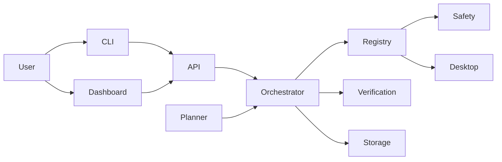

# OMNI

OMNI is a lightweight desktop orchestration prototype for local task execution and verification. It focuses on a safe, workspace-bound planner, a small action registry, a CLI, a local dashboard, and a deterministic end-to-end demo that can complete without a remote model.

## Quick start

```bash
python3 -m pip install -e .
python3 -m omni.main status
python3 -m omni.main run-demo --workspace ./workspace/demo
python3 -m omni.main dashboard --host 127.0.0.1 --port 8000
```

## Features

- Task intake and structured plan generation.
- Safe action registry with permission checks.
- Dependency-aware orchestrator with retries and cancellation.
- Local verification engine for file, process, and test outcomes.
- Hyprland-aware desktop adapter with graceful fallback.
- Web dashboard and FastAPI API.
- Demo mode for deterministic delivery.

## Architecture



## Safety model

- All filesystem actions are limited to the configured workspace.
- No arbitrary shell commands are allowed.
- Only registered action names can be executed.
- User approval is required for consequential actions.
- Verification is mandatory before a step is marked successful.

## Testing

```bash
pytest -q
```
