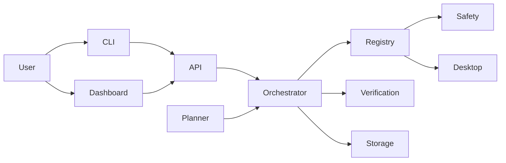

# OMNI

OMNI is a lightweight desktop orchestration prototype for local task execution and verification. It focuses on a safe, workspace-bound planner, a small action registry, a CLI, a local dashboard, and a deterministic end-to-end demo that can complete without a remote model.

## Quick start

```bash
python3 -m pip install -e .
python3 -m omni.main status
python3 -m omni.main run-demo --workspace ./workspace/demo
python3 -m omni.main dashboard --host 127.0.0.1 --port 8000
```

## Features

- Task intake and structured plan generation.
- Safe action registry with permission checks.
- Dependency-aware orchestrator with retries and cancellation.
- Local verification engine for file, process, and test outcomes.
- Hyprland-aware desktop adapter with graceful fallback.
- Web dashboard and FastAPI API.
- Demo mode for deterministic delivery.

## Architecture



## Safety model

- All filesystem actions are limited to the configured workspace.
- No arbitrary shell commands are allowed.
- Only registered action names can be executed.
- User approval is required for consequential actions.
- Verification is mandatory before a step is marked successful.

## Testing

```bash
pytest -q
```


## Event coordination (Phase 2)

`omni.events.EventBus` provides ordered asyncio publish/subscribe events:
`context.update`, `intent.decision`, `modules.plan`, `sched.load`, and
`task.reward`. `RoutingEventBridge` publishes the outputs of the existing
`RoutingService`; it does not replace IARS, AMPL, or KRLS.

Reward consumers can connect to the bridge with `connect_iars` and
`connect_scheduler`. Learning updates occur only when the reward event
includes the corresponding feature data and selected agent/action IDs.
The event bus is in-process; it is not a cross-process message broker.

The existing scheduler uses OS-level cgroup v2 controls where available.
Scheduler actuation remains dry-run unless explicitly enabled through the
existing CLI. This phase does not claim kernel-level scheduling or
per-process supervision beyond the existing actuator's supported behavior.


## Desktop action safety (Phase 3)

The explicit desktop registry is available through
`omni.desktop.DesktopActionRegistry`.

- `read-only`: workspace filename search.
- `reversible`: approved application launch, Hyprland focus/workspace,
  volume, brightness, Wi-Fi, and media controls.
- All reversible actions require a short-lived, one-use confirmation token.
- No arbitrary shell command action is exposed.
- Application launches use a fixed allowlist.
- Hyprland window addresses and workspace numbers are validated.
- External commands are passed as argument arrays, never through a shell.
- The desktop registry is an opt-in interface; it is not silently wired
  into the task orchestrator or HUD.

A missing executable returns an unavailable result. Hardware controls
depend on the relevant Linux desktop utility and permissions being present.


## Voice input and output (Phase 4)

Optional local voice commands:

- `python3 -m omni.voice.service listen`
- `python3 -m omni.voice.service speak "Hello from OMNI"`

Install optional packages in the active Python environment:

`python3 -m pip install sounddevice faster-whisper pyttsx3`

Microphone capture is explicit and terminal-controlled: press Enter to
start, then Enter to stop. Audio is stored in a temporary WAV file only
for transcription and is deleted afterward. No always-on microphone
listener is installed.

Speech recognition uses faster-whisper when installed. The default model
is `base`; configure `OMNI_WHISPER_MODEL`, `OMNI_WHISPER_DEVICE`, and
`OMNI_WHISPER_COMPUTE` to change its local runtime settings.

Speech output uses pyttsx3 when installed. If either local engine or
microphone capture is unavailable, OMNI can continue with text input and
text output. Voice commands are not automatically executed as desktop
actions; the existing desktop confirmation flow still applies.
