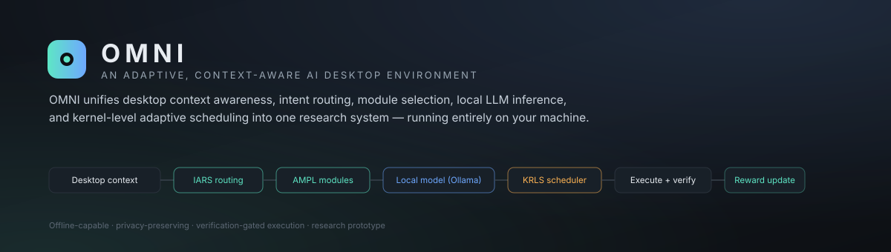
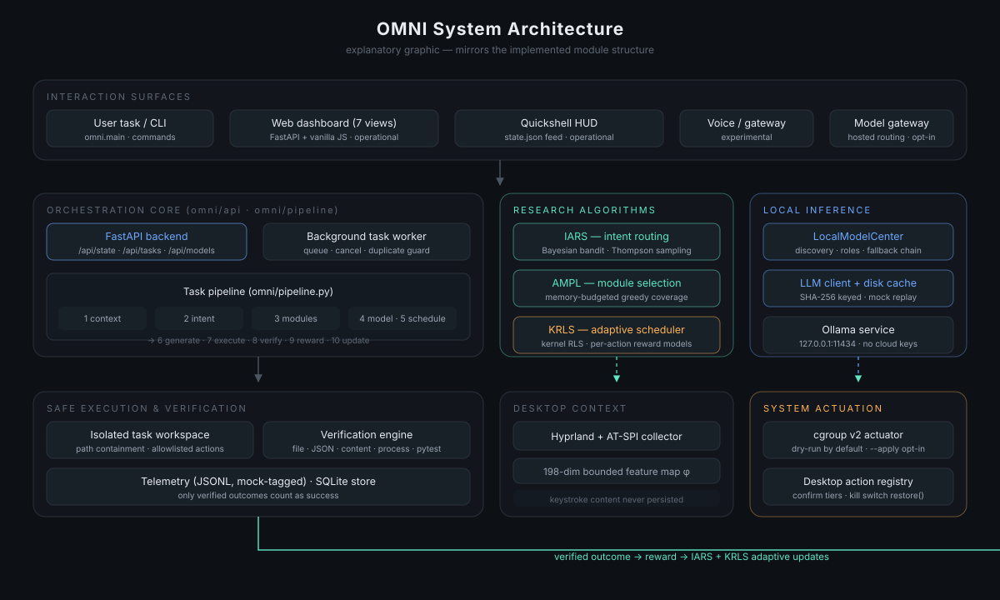
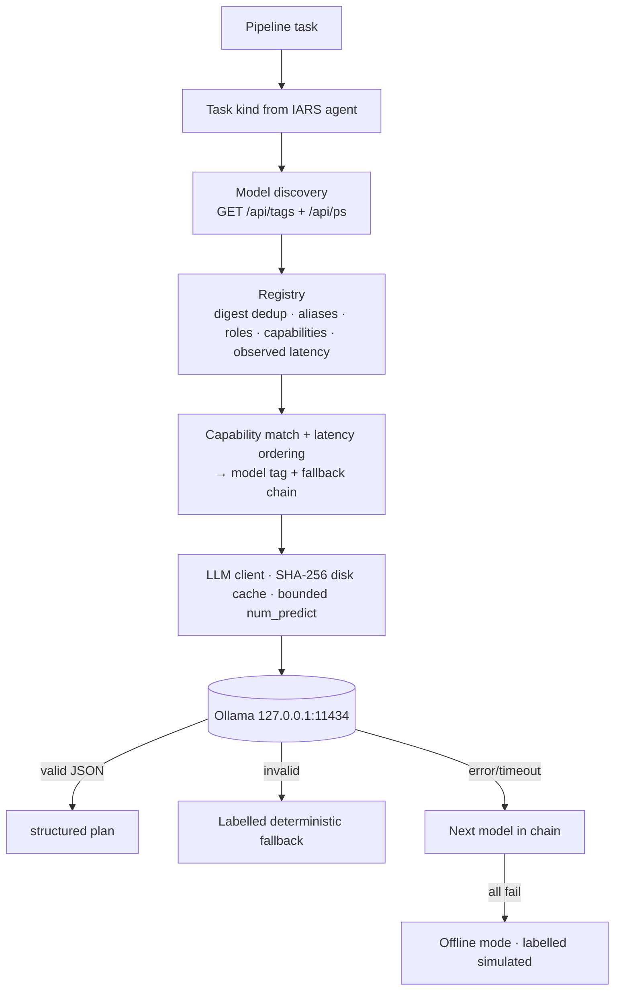
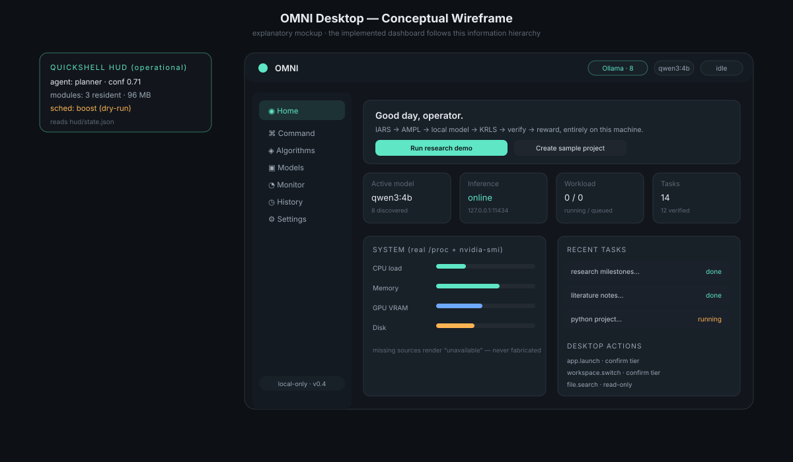
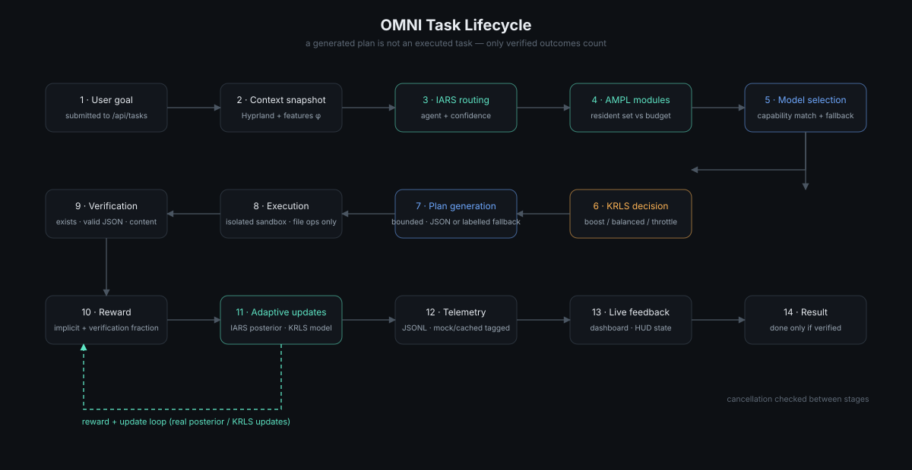

<div align="center">



# OMNI

**An adaptive, context-aware AI desktop environment — built on local inference.**

OMNI routes every user task through desktop context analysis, learned intent
routing, memory-budgeted module selection, local LLM inference and kernel-level
adaptive scheduling — then executes safely, verifies independently, and feeds
the outcome back into its own models. No cloud API keys required.

`Python 3.12+` · `Ollama local inference` · `Hyprland/Linux` · `FastAPI + vanilla JS` · `103 tests passing`

[Overview](#-overview) · [Research](#-research-contributions) · [Architecture](#-architecture) · [Algorithms](#-algorithm-explanations) · [Desktop](#-desktop-experience) · [Install](#-installation) · [Quick start](#-quick-start) · [Benchmarks](#-benchmarking) · [Roadmap](#-roadmap) · [Docs](docs/README.md)

</div>

---

## 📌 Project status

| Badge | Meaning |
|---|---|
|  | minimum supported version (`pyproject.toml`); verified on 3.14 |
|  | `python3 -m pytest -q` at time of writing |
|  | discovery, selection and generation against `127.0.0.1:11434` |
|  | verified on Hyprland 0.56; graceful degradation elsewhere |
|  | research prototype (`pyproject.toml`) |

> No CI workflow or license is configured yet, so no such badges are shown.
> See [Limitations](#-limitations) before judging maturity.

---

## 🧭 Overview

OMNI is a **desktop-oriented research system** that asks a simple question:

> *What if the desktop itself could observe context, infer intent, select the
> right local model, adapt its scheduling to real system pressure — and prove
> that its actions actually worked — without sending anything to the cloud?*

Every task flows through one pipeline:

```mermaid
flowchart LR
    U[User task / desktop event] --> CTX[Context collection<br/>Hyprland + AT-SPI · 198-dim features]
    CTX --> IARS[IARS intent analysis<br/>Bayesian bandit routing]
    IARS --> AMPL[AMPL decision<br/>memory-budgeted module selection]
    AMPL --> SEL[Local model selection<br/>capability-aware, Ollama]
    SEL --> KRLS[KRLS scheduling<br/>per-action kernel RLS]
    KRLS --> GEN[Plan generation<br/>bounded, structured]
    GEN --> EXE[Task execution<br/>isolated sandbox]
    EXE --> VER[Independent verification]
    VER --> RWD[Reward feedback]
    RWD --> UPD[Adaptive updates<br/>IARS + KRLS]
    UPD --> UI[Live desktop feedback<br/>dashboard + HUD]
```



Three properties make this interesting as research:

1. **The algorithms actually drive the system.** The routed agent determines
   the model capability class; the module plan is applied to real residency; the
   scheduler's chosen action receives the verified task reward.
2. **Only verified outcomes count.** Execution is gated by an independent
   verification engine; a generated plan is never treated as an executed task.
3. **Honest telemetry.** Mock/cached records are tagged and excluded from
   paper figures; missing data suppresses figures rather than faking them.

## 🌌 Vision

Desktop AI assistants today are either cloud-dependent agents that act on your
files with little context, or static launchers that ignore system state. OMNI's
thesis is that an intelligent desktop needs *all three loops at once* —
**context → decision → consequence** — with each loop measurable and
ablatable. The near-term vision is a background agent lifecycle that persists
across app switches; the current release establishes the algorithmic and
execution foundation for it.

## ✨ Core features

| Area | Capability | Status |
|---|---|---|
| Context awareness | Hyprland windows/workspaces, AT-SPI events, bounded 198-dim feature map | 🟢 operational |
| Intent analysis | IARS Thompson-sampled Bayesian routing with confidence + exploration | 🟢 operational |
| Adaptive routing | agent choice → model capability class; posterior updated from outcomes | 🟢 operational |
| AMPL processing | memory-budgeted greedy module selection, residency accounting | 🟢 operational |
| KRLS scheduling | per-action kernel RLS models, cgroup v2 actuation (dry-run default) | 🟢 operational |
| Local model inference | Ollama-only, bounded generation, disk-cached, timeouts | 🟢 operational |
| Model discovery | live `/api/tags` discovery, digest alias dedup, capability matching, fallback chains | 🟢 operational |
| Safe execution | isolated per-task sandbox, path containment, allowlisted desktop actions | 🟢 operational |
| Verification | file/JSON/content/process/pytest checks; verified-only success | 🟢 operational |
| Reward feedback | implicit reward from verified outcomes → real learner updates | 🟢 operational |
| Dashboard | 7-view UI reading live backend state; real-data-only charts | 🟢 operational |
| HUD | Quickshell overlay reading shared state file | 🟢 operational |
| Benchmarking | 30-task bench harness, strict real-run reporting, figure refusal on missing data | 🟢 operational |
| Ablation experiments | 5-config pilot with genuine component removal | 🟢 pilot-scale |
| Telemetry | JSONL with mock/cached tagging | 🟢 operational |
| Background agent lifecycle | long-lived per-app agents across switches | 🟡 planned |
| Desktop automation breadth | visual UI agent, window-layout actions | 🟡 planned |
| Voice interface | wake/STT pipeline | 🟠 experimental stub |
| Cross-session model persistence | IARS/KRLS posterior save/restore | 🟡 planned |

🟢 operational · 🟡 planned · 🟠 experimental

## 🔬 Research contributions

OMNI implements and integrates three algorithmic components. Their precise
mathematics, inputs and outputs are documented in [docs/research/](docs/research/)
— the summaries below match the source code.

### 1. IARS — implicit intent analysis & routing

A **per-agent Bayesian linear bandit** over a bounded 198-dim desktop context
map. Thompson-sampled utilities `s(a) = θₐᵀφ − λ_cost·costₐ − λ_load·loadₐ` are
computed per agent; softmax confidence decides between acting directly and
exploring the top-2 with a lexical verifier. Outcomes feed back through
Sherman–Morrison precision updates — no user labels required.

**Downstream influence:** the routed agent maps to a model capability class
(`code`, `planning`, `general`, …), which selects the local model preference
list. This is the pipeline's primary intent → model pathway.

### 2. AMPL — memory-budgeted module selection

Given a real memory-pressure budget (MemAvailable ramp + PSI mapping) and an
app-derived capability demand, AMPL performs **greedy marginal-gain selection**
of capability modules against an expected-coverage objective, compares against a
best-single-module baseline, boosts uncovered capability demand, and evicts by
lowest utility. The resident set and footprint (MB, M-params) are recorded per
task and published to the HUD.

> The repository uses AMPL as project terminology for this selection layer; no
> formal acronym expansion is claimed.

### 3. KRLS — kernel recursive least squares scheduler

An **online kernel-based reward model per scheduling action** (`boost`,
`balanced`, `throttle`): RBF kernel, ALD sparsification with a bounded
dictionary, block Sherman–Morrison inverse updates, fed by six real features
(`/proc/loadavg`, CPU PSI, memory pressure, window focus/interactivity). The
argmax action is dry-run applied to cgroup v2 (opt-in `--apply`), and the
verified task reward updates the model of the action actually taken.

### Research integrity

| Component | Implemented | Integrated | Validated |
|---|:---:|:---:|---|
| IARS routing + learning | ✅ | ✅ gates model class; updated by outcomes | unit + pipeline tests; pilot ablation |
| AMPL selection | ✅ | ✅ plan applied to residency | unit tests; magnitude not yet measured |
| KRLS scheduler | ✅ | ✅ dry-run actuation + reward updates | unit + simulator tests; single-session learning |
| Local model infrastructure | ✅ | ✅ gates generation | discovery/dedup/fallback tests + real-inference demo |
| Safe execution + verification | ✅ | ✅ verified-only success | pipeline tests; 30-task bench harness |
| Background agent lifecycle | ❌ | — | planned |

Details: [docs/research/iars.md](docs/research/iars.md) ·
[ampl.md](docs/research/ampl.md) · [krls.md](docs/research/krls.md) ·
[validation-status.md](docs/research/validation-status.md)

## 🏗 Architecture



- **High-level flow** — the diagram above; full description in
  [docs/architecture/system-architecture.md](docs/architecture/system-architecture.md).
- **Algorithm interaction** — data-flow view with real dependencies:
  [algorithm-interaction.md](docs/architecture/algorithm-interaction.md).
- **Desktop architecture** — surfaces, context, actuation, planned components:
  [desktop-integration.md](docs/architecture/desktop-integration.md).

<details>
<summary><strong>Repository layout</strong></summary>

```
omni/
  api/            FastAPI backend (state, tasks, models, algorithms, settings)
  pipeline.py     end-to-end task pipeline + background worker
  local_models.py Ollama discovery, registry, capability selection
  llm/            cached LLM client (SHA-256 keyed), embeddings
  routing/        IARS bandit + agents + lexical verifier
  modules/        AMPL library, descriptor, memory-pressure budget
  scheduler/      KRLS core, policy, context features, cgroup actuator, simulator
  context/        Hyprland collector, AT-SPI fallback, feature maps
  desktop/        allowlisted desktop action registry
  verification/   independent verification engine
  orchestrator/   classic demo orchestrator (plan/approve/execute)
  bench/          bench runner, adapters, strict real-run reporting
  hud/            HUD state publisher
dashboard/        7-view web UI (vanilla JS, glass/graphite theme)
hud/              Quickshell QML HUD
tests/            103-test suite (mock inference only)
research/results/ pilot ablation artifacts + research docs
docs/             architecture, research, design, development documentation
```
</details>

## ⚙️ Algorithm explanations

Compact formulations; full versions with parameter values live in
[docs/research/](docs/research/).

<details>
<summary><strong>IARS — decision & update equations</strong></summary>

- One Bayesian linear model per agent: precision `A = A₀ + Σ wᵢ φᵢφᵢᵀ`,
  `b = Σ wᵢ rᵢ φᵢ`, mean `μ = A⁻¹b`, covariance `A⁻¹` (Sherman–Morrison updates).
- Thompson sample `θₐ ~ N(μₐ, Σₐ)`; utility `s(a) = θₐᵀφ − λ_c·costₐ − λ_l·loadₐ`.
- Confidence `conf = softmax(s)ₐ*` (temperature 0.35); explore top-2 with a
  lexical verifier when `conf < τ` (0.55).
- Implicit reward: `accepted − 0.5·undo − 0.5·edit_norm − 0.2·latency_norm`.
- Priors: curated lexical embedding of agent descriptions (no neural embedding
  wired yet — documented limitation).
</details>

<details>
<summary><strong>AMPL — selection objective</strong></summary>

- Demand `d(u)` over capability units from the app descriptor; per-module
  effective weights from covered units.
- Expected coverage with diminishing returns under weighted module composition;
  utility objective balances coverage against size.
- Constrained by real budget: `pressure = max(available-ramp, PSI/50)`,
  `budget = max_budget · max(0.15, 1 − pressure)`.
- Greedy marginal-gain selection vs best-single baseline; miss-driven weight
  boost; utility-ordered eviction.
</details>

<details>
<summary><strong>KRLS — kernel update</strong></summary>

- RBF kernel dictionary with ALD sparsification (budget 48 centres).
- Block Sherman–Morrison inverse updates of the kernel matrix per observation.
- Six features from `/proc` + window state; per-action models predict reward;
  argmax action applied via the cgroup v2 actuator (dry-run by default).
- Untrained policy reports `heuristic-prior` design scores; after real reward
  updates it reports `krls` — both states are visible in the dashboard.
</details>

## 🧠 Local model infrastructure



Full description: [docs/architecture/local-inference.md](docs/architecture/local-inference.md).

| Model | Preferred responsibility |
|---|---|
| qwen3:4b | general reasoning, planning, orchestration |
| qwen3:1.7b | fast intent classification, lightweight tasks |
| llama3.2:3b | general-purpose alternative |
| phi4-mini | reasoning, analytical tasks |
| gemma3:4b | general tasks, image-capable workflows |
| qwen2.5-coder:3b | code generation and analysis |
| deepseek-r1:1.5b | lightweight reasoning comparison |
| nomic-embed-text | embeddings, semantic retrieval |

**Your installed set is discovered at runtime** — the table above is a
capability *preference map*, not a hardware requirement, and roles are
design-time preferences rather than benchmark claims. Any subset of Ollama
models works.

## 🖥 Desktop experience



The implemented dashboard ships seven views on a dark graphite/glass theme:

| View | What it shows |
|---|---|
| **Home** | active model, inference status, real CPU/mem/GPU/disk, workload, recent tasks, quick actions |
| **AI Command Center** | submit a natural-language task; watch the live pipeline: intent → AMPL → model → scheduling → execution → verification → reward |
| **Algorithm Observatory** | live IARS/AMPL/KRLS state, update counts, decision history, reward trail |
| **Local Model Center** | installed models with roles, capabilities, observed latency, manual pin / auto-routing |
| **System Monitor** | real `/proc` + `nvidia-smi` metrics; unavailable sources say "unavailable" |
| **History** | every task with intent, model, scheduling action, duration, verification, reward |
| **Settings** | Ollama endpoint, model preference, inference limits, safe mode, offline mode |

Additional wireframes (explanatory mockups, not screenshots):
[command-center](docs/assets/command-center.svg) ·
[algorithm-observatory](docs/assets/algorithm-observatory.svg) ·
[model-center](docs/assets/model-center.svg)

The Quickshell **HUD** mirrors live routing, module residency and scheduling
state on the desktop (`python3 -m omni.main hud`).

## 📦 Installation

**Requirements:** Linux (developed on Hyprland), Python 3.12+, Ollama for local
inference (optional in offline mode). No GPU required.

```bash
git clone https://github.com/RespectedBibaswanSarkar/OMNI_DESKTOP_ENV.git
cd OMNI_DESKTOP_ENV

python3 -m venv .venv && source .venv/bin/activate
python3 -m pip install -e .

# optional: pull local models (any subset; discovery is runtime-based)
ollama pull qwen3:4b
ollama pull qwen2.5-coder:3b
```

## 🚀 Quick start

```bash
./run_omni.sh                  # checks deps + Ollama, prints the dashboard URL
# → dashboard: http://127.0.0.1:8000/static/index.html

./run_omni.sh --offline        # no Ollama needed; outputs labelled "simulated"
```

Then open the **AI Command Center** and submit:

> *Analyse my research project and organize its next milestones.*

Watch the pipeline stages, the verification checks, and the reward/update
telemetry in the Observatory. Everything executes in an isolated sandbox under
`workspace/isolated/`.

<details>
<summary><strong>Try the CLI instead</strong></summary>

```bash
python3 -m omni.main status            # stack status
python3 -m omni.main run-demo --workspace ./workspace/demo   # deterministic demo
python3 -m omni.main route --once      # one IARS + AMPL + KRLS cycle
python3 -m omni.main schedule --once   # scheduler decision (dry-run)
python3 -m omni.main schedule --simulate all --steps 400     # labelled simulation
python3 -m omni.main bench --list      # benchmark task list
python3 -m omni.main hud               # Quickshell HUD
```
</details>

## 🛠 Usage

- **Submit tasks** from the Command Center or `POST /api/tasks
{"goal": "..."}` — execution is asynchronous; poll `/api/tasks/{id}` or watch
the dashboard.
- **Switch models** in the Model Center (manual pin) or leave auto-routing on.
- **Ablate** via Settings/observatory flags or `omni.experiment.py` configs —
  disabling a component removes it from the decision path entirely.
- **Control the scheduler**: decisions are dry-run by default;
  `python3 -m omni.main schedule --apply` actuates, `--restore` is the kill
  switch.
- **Safety model**: isolated workspaces, path containment, allowlisted desktop
  actions with confirmation tiers, no arbitrary shell from model output.

Full details: [docs/development/configuration.md](docs/development/configuration.md).

## 🔧 Configuration

Key environment variables (all optional):

| Variable | Default | Purpose |
|---|---|---|
| `OMNI_OLLAMA_URL` | `http://127.0.0.1:11434` | local inference endpoint |
| `OMNI_LLM_MOCK` | unset | `1` → forced mock (offline) |
| `OMNI_CACHE_DIR` | `~/.cache/omni` | caches, telemetry, HUD state |
| `OMNI_WORKSPACE` | `./workspace` | sandbox root |
| `OMNI_PORT` | `8000` | dashboard port |

Dashboard settings persist to `~/.cache/omni/dashboard_settings.json`.
See [configuration.md](docs/development/configuration.md) for the complete list.

## 📊 Benchmarking



- **Bench harness** (`omni.main bench`): 30 deterministic offline tasks with
  programmatic verifiers; adapters for `mock`, `opencode` (installed CLI), and
  explicitly-unavailable backends that record the reason instead of fabricating
  runs. Reports refuse figures when expected real runs are missing.
- **Pilot ablation** (`python3 -m omni.experiment`): 5 fixed tasks × 5
  configurations (full / no-IARS / no-AMPL / no-KRLS / baseline), generation
  mocked and labelled, everything else real.

**Pilot results (25 runs, mocked generation, single seed):** all ablations ran
with 5/5 verified tasks; ablations demonstrably changed routing agents, model
selection and update counts (e.g. IARS updates 5 → 0 when ablated; KRLS policy
switched from `heuristic-prior` to `krls` only in configs with reward feedback).

> ⚠️ **These are pilot-scale integration results, not a comparative benchmark.**
> No superiority claims are made against AIOS or any other system.

Artifacts: [`research/results/`](research/results/EXPERIMENT_RESULTS.md)
(summary.json, results.csv, runs.jsonl, figures) ·
Methodology: [experimental-methodology.md](docs/research/experimental-methodology.md)

## 🗺 Roadmap

1. **Background agent lifecycle** — persistent per-app agents that survive
   workspace/app switches (planned).
2. **Posterior persistence** — save/restore IARS and KRLS state across
   restarts (planned).
3. **Neural embedding priors** — wire `nomic-embed-text` into IARS priors
   (planned; API exists).
4. **Measured AMPL artifacts** — replace design-prior module sizes with real
   LoRA/tool-schema measurements (planned).
5. **sched_ext backend** — behind the existing actuator interface (planned).
6. **Extended desktop automation** — window-layout actions, visual UI agent
   (planned).
7. **CI workflow** — GitHub Actions for the test suite (planned).
8. **License selection** — none is configured yet; owner decision required.

## ⚠️ Limitations

- **Not a fully autonomous desktop agent.** The background agent lifecycle and
  broad desktop-level task execution are incomplete: the pipeline executes
  sandboxed file tasks with verification; window-level automation is limited to
  the allowlisted registry.
- **Pilot-scale evidence only.** 25 ablation runs, mocked generation, single
  seed; no statistical comparisons.
- **AMPL magnitudes unmeasured.** Module sizes/params are hand-authored design
  priors.
- **No cross-session learner persistence.** IARS/KRLS state resets on restart.
- **Platform-specific features.** cgroup actuation and Hyprland context need
  Linux/Hyprland; other systems degrade to reduced context (reported, never
  faked).
- **No license configured.** Inherited personal project; owner must choose.
- Full ledger: [research/results/LIMITATIONS.md](research/results/LIMITATIONS.md)
  · [docs/research/validation-status.md](docs/research/validation-status.md)

## 🤝 Contributing

See [CONTRIBUTING.md](CONTRIBUTING.md). The short version: keep the suite
green, keep the algorithms honest (no heuristic-swap-under-same-name), keep
privacy and safety defaults, and label stubs.

## 📚 Citation

No paper is published yet, so the following is a **provisional template** for
citing the software (fill in the access date/version you use):

```bibtex
@software{omni_desktop_env,
  author  = {Sarkar, Bibaswan},
  title   = {OMNI: An Adaptive, Context-Aware AI Desktop Environment
             with Local Inference and Adaptive Scheduling},
  year    = {2026},
  url     = {https://github.com/RespectedBibaswanSarkar/OMNI_DESKTOP_ENV},
  note    = {Research prototype; pilot-scale validation only}
}
```

## 📄 License

No license has been selected yet. All rights remain with the author until a
license is added. (A license change requires the owner's explicit decision.)

---

<div align="center">
<sub>Built as a research prototype: Hyprland · FastAPI · Ollama · NumPy · vanilla JS.
Every metric shown in OMNI comes from a real source — or is reported as unavailable.</sub>
</div>
