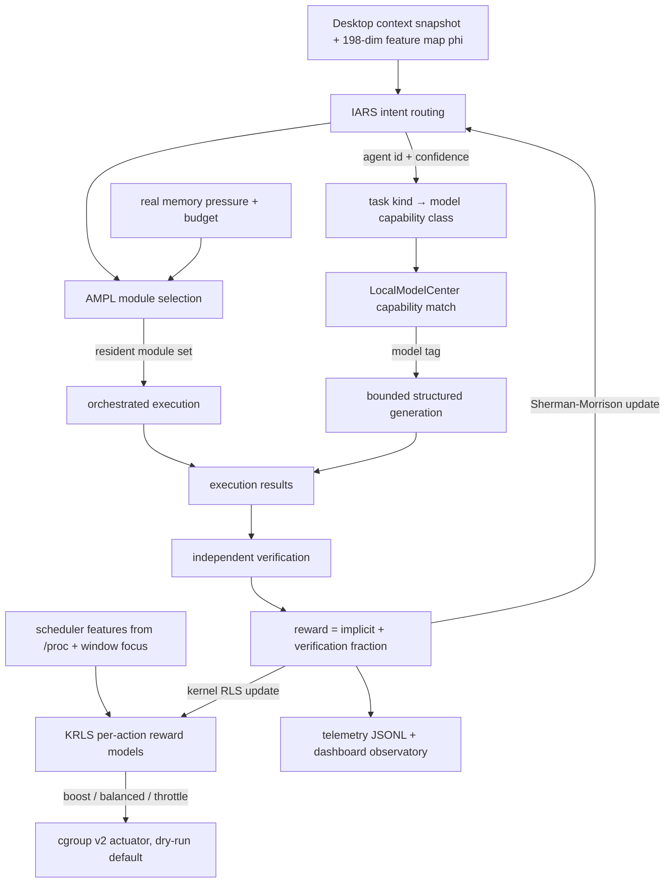

# Algorithm Interaction

## What each arrow really means

- **IARS → model class.** The routed agent id maps to a task kind
  (`file-ops → general`, `dev-terminal → code`, `planner → planning`, …) which
  selects the capability preference list. This is the primary way routing
  influences downstream behaviour.
- **AMPL ↔ real memory.** `measure_memory` maps MemAvailable and CPU PSI into a
  budget; AMPL's greedy selection runs against that budget, and the residency
  footprint is recorded per task.
- **KRLS → actuator → reward.** The chosen action is applied (dry-run unless
  `--apply`) and later receives the task reward via `KRLSPolicy.update`. Until
  the first reward arrives the policy reports `heuristic-prior`; afterwards it
  reports `krls`.
- **Reward loop.** Both learners update on the same observable outcome. With
  ablations enabled, updates stop — verified in the pilot experiment
  ([research/results/summary.json](../../research/results/summary.json)).
