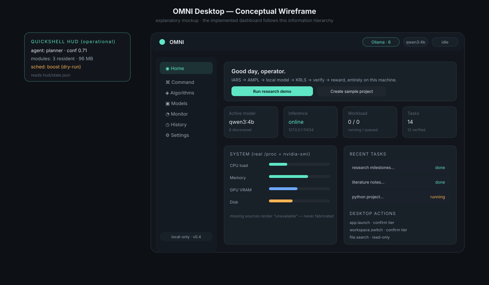

# Desktop Integration

## Context awareness (operational)

- `omni/context/hyprland.py` — Hyprland IPC (compositor windows, workspaces,
  focused window, event stream), optional low-res screenshot stats
  (`OMNI_SCREENSHOT=1`, never stored unless `OMNI_DEBUG_FRAMES=1`).
- `omni/context/atspi.py` — accessibility tree via `gdbus`/AT-SPI DBus fallback
  (no PyAT-SPI dependency); global, bounded event histogram.
- `omni/context/features.py` — bounded 198-dim feature map: hashed app bucket,
  title text embedding, time/clipboard-type features. **Keystroke content is
  never persisted — clipboard *types* only.**

## Allowlisted desktop actions (operational)

`omni/desktop/actions.py` implements a closed registry — no arbitrary shell
execution from model output:

| Action | Tier | Confirmation |
|---|---|---|
| file.search | read-only | not required |
| app.launch | reversible | required |
| window.focus | reversible | required |
| workspace.switch | reversible | required |
| volume.set / brightness.set | reversible | required |
| wifi.set / media.control | reversible | required |

Sensitive or irreversible operations require an explicit `prepare()` →
`confirm(token)` handshake; unavailable tools are reported as unavailable rather
than faked.

## Scheduling actuation (operational, opt-in)

`omni/scheduler/actuator.py` writes cgroup v2 `cpu.weight` / `io.weight` for the
user slice, records originals, and supports `restore()` as a kill switch.
Dry-run is the default; `--apply` (or `schedule --apply`) is required for real
writes, and no process is ever moved without an explicit pid. A sched_ext
backend is **planned** behind the same interface.

## HUD (operational)

Quickshell (0.3.2) reads `~/.cache/omni/hud/state.json` (`OMNI_HUD_STATE` to
override). Both the routing service and the task pipeline publish live agent,
module, scheduler and pipeline-stage keys to this file.

## Planned / experimental

- Background agent lifecycle across app switching: **planned** (single-task
  worker exists; no long-lived per-app agent yet).
- Voice interface: **experimental** stub.
- Visual UI agent (screen-understanding actions): **planned** (context exists,
  no actuator).
