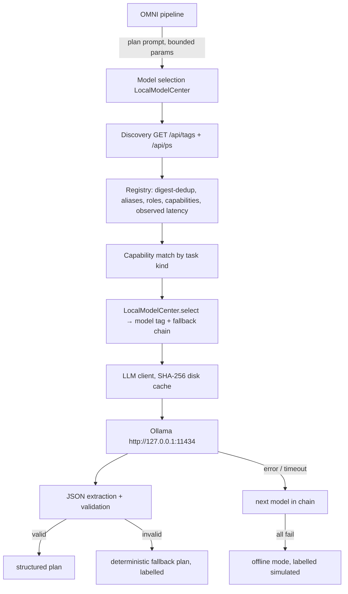

# Local Inference Architecture

## Principles

- **Ollama-only.** No OpenRouter or cloud path in the default pipeline; a hosted
  gateway exists as separate opt-in code (`omni/gateway.py`).
- **Discovery over assumption.** The registry is built from the live `/api/tags`
  response. Models installed on one developer's machine are not assumed to exist
  elsewhere; missing models are skipped in the preference order.
- **Digest deduplication.** Tags with identical digests are merged as aliases
  (e.g. `llama3.2:latest` ≡ `llama3.2:3b` when they resolve to the same weights).
- **Capability-aware selection.** Task kind → preference list
  (e.g. `code → qwen2.5-coder:3b > qwen3:4b > llama3.2:3b > qwen3:1.7b`),
  observed latency breaks ties and orders the rest of the chain; embedding-only
  models are excluded from generation.
- **Bounded.** `num_predict` caps generation; requests carry wall-clock timeouts;
  failures move to the next model and, failing that, to a clearly-labelled
  deterministic fallback.
- **Cache discipline.** Every request is keyed by SHA-256(backend+model+prompt+
  params); cache hits are flagged `cached` and excluded from paper figures.

## Roles (design-time preferences, not benchmark claims)

| Model | Preferred responsibility |
|---|---|
| qwen3:4b | general reasoning, planning, orchestration |
| qwen3:1.7b | fast intent classification, lightweight tasks |
| llama3.2:3b | general-purpose alternative |
| phi4-mini | reasoning and analytical tasks |
| gemma3:4b | general tasks, image-capable workflows |
| qwen2.5-coder:3b | code generation and analysis |
| deepseek-r1:1.5b | lightweight reasoning comparison |
| nomic-embed-text | embeddings, semantic retrieval |

Your installed set is discovered at runtime; any subset of the above (or other
Ollama models) works, with roles assigned by prefix match.
