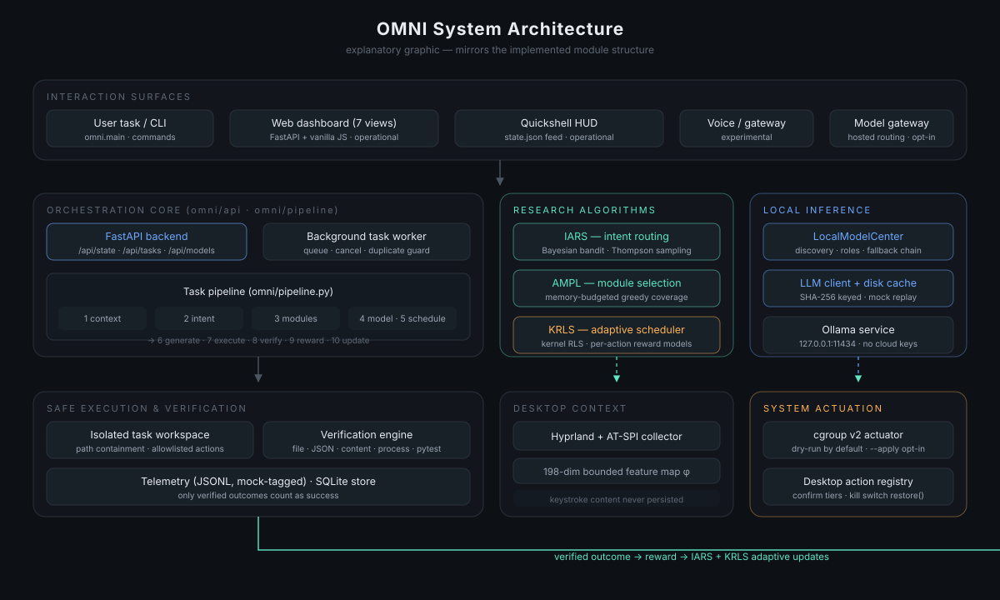

# System Architecture

## Layers

| Layer | Modules | Status |
|---|---|---|
| Interaction surfaces | CLI (`omni.main`), FastAPI dashboard, Quickshell HUD | operational |
| Orchestration core | `omni/api`, `omni/pipeline` (background worker, queue, cancellation) | operational |
| Research algorithms | `omni/routing` (IARS), `omni/modules` (AMPL), `omni/scheduler` (KRLS) | operational |
| Local inference | `omni/local_models`, `omni/llm` (disk cache) | operational |
| Context | `omni/context` (Hyprland events, AT-SPI via gdbus, 198-dim features) | operational |
| Execution & verification | isolated task workspaces, `omni/verification`, `omni/desktop` action registry | operational |
| Actuation | cgroup v2 actuator (dry-run default), desktop action registry with confirm tiers | operational |
| Voice / hosted gateway | `omni/voice`, `omni/gateway`, `omni/openrouter` | experimental / opt-in |

## API surface

- `GET /api/state` — system metrics, inference status, workload, recent tasks.
- `POST /api/tasks` / `GET /api/tasks/{id}` / `POST /api/tasks/{id}/cancel` — pipeline submission and tracking.
- `GET /api/algorithms` — live IARS / AMPL / KRLS observatory data.
- `GET /api/models` (+ `select`, `refresh`) — model registry and switching.
- `GET /api/system` — real CPU / memory / disk / GPU readings.
- `GET|POST /api/settings` — persisted configuration.
- Legacy orchestrator endpoints (`/tasks*`) remain available.

## Responsiveness rules

- Model inference runs on a daemon worker thread; the API and dashboard poll.
- Generation is bounded (`num_predict`, wall-clock timeout) with a fallback
  chain across models.
- Ollama being down degrades the system to an explicitly-labelled offline mode;
  the dashboard remains usable.
