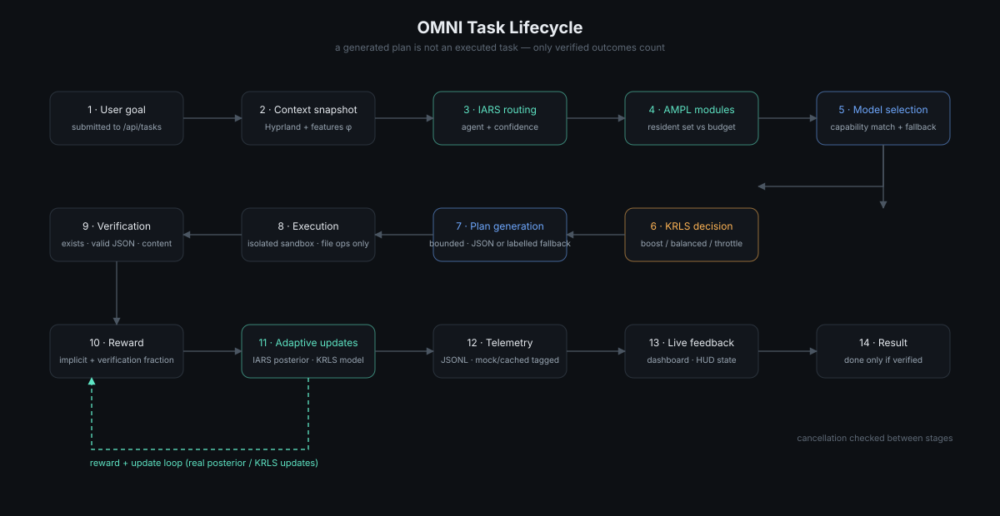

# Task Lifecycle

## Stage notes (implemented behaviour)

1. **Intake.** `POST /api/tasks` enqueues the goal; identical in-flight goals are
   deduplicated; cancellation is checked between stages.
2. **Context.** A Hyprland/AT-SPI snapshot is taken; failure is recorded and the
   pipeline continues with the goal text alone.
3. **Intent.** IARS produces agent, confidence, scores, exploration flag; with
   IARS ablated, a static keyword table routes instead (and no update occurs).
4. **Modules.** AMPL's plan is applied to residency; the plan, objective and
   memory state are recorded.
5. **Model.** Capability-aware selection with an explicit fallback chain; a
   manual pin overrides auto-routing.
6. **Scheduling.** The KRLS decision is dry-run applied by default.
7. **Generation.** The local model returns a bounded JSON plan. Unparseable
   output falls back to a deterministic plan and is labelled
   `generation_fallback: true` — never silently reinterpreted.
8. **Execution.** Only `mkdir`, `write_file`, `write_json` inside a per-task
   sandbox; path containment is enforced before any write.
9. **Verification.** Every planned file is checked (exists, valid JSON,
   meaningful content). Checks are independent of execution success claims.
10. **Reward & updates.** reward = `IARS.implicit_reward(accepted=verified,
latency)` + 0.2 × passed-check fraction; both learners update from it.
11. **Telemetry.** JSONL records tagged `mock`/`cached` so benchmark aggregation
can exclude them.
